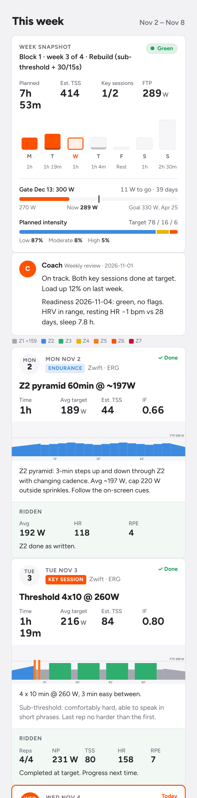

# Zwift AI Coach

A small, file-based cycling coach that plans your season, writes structured workouts straight into Zwift, and adjusts them every day from your recovery data and your last ride.

Built for one rider chasing **289 → 330 W FTP over a winter on Zwift**. Shared as a template you can adapt.



## What it does

- **Plans the season.** Blocks of 3 build weeks + 1 recovery week, with FTP test gates along the way. Pyramidal intensity in the base phase, polarized before the peak. The reasoning and sources are in [`research/`](research/aerobic-anaerobic-balance.md)
- **Writes the workouts.** Every session is generated in exact watts and saved as a Zwift custom workout (`.zwo`), one fixed slot per weekday, so Zwift's list never fills up
- **Adjusts daily.** Each morning it reads Apple Health readiness (HRV, resting HR, sleep, breathing rate) and yesterday's Strava ride. Hit every rep with heart rate to spare: the next session progresses. Poor recovery: today gets trimmed or swapped for a recovery spin, and the key session moves to a safe day
- **Reviews weekly.** Hours, training load, intensity split against target, key sessions hit, best efforts, gate status, then it builds next week
- **Keeps easy days interesting.** Z2 rides rotate through cadence ladders, seated hills, 10-s sprinkles and power pyramids instead of flat steady riding
- **Shows up where you look.** An optional phone page with the week as an activity feed, and optional calendar blocks around your work schedule

## How it runs

The engine is plain Python. The coaching judgement comes from an AI assistant (built and run with [Claude](https://claude.ai)) that follows a written rulebook, [`COACH.md`](COACH.md), on a schedule:

| When | Routine | Prompt |
|---|---|---|
| Every morning | Read readiness and yesterday's ride, score key sessions, progress or trim, rewrite today's Zwift file | [`prompts/daily-routine.md`](prompts/daily-routine.md) |
| Sunday evening | Weekly review and next week's plan | [`prompts/weekly-review.md`](prompts/weekly-review.md) |

The assistant needs access to this folder, your Strava account and, if you use the calendar blocks, Google Calendar. You can also run every tool by hand without any AI.

## Quick start

Requirements: Python 3.9+, `numpy` (for ride metrics only), Zwift with a smart trainer.

```bash
git clone https://github.com/<you>/zwift-ai-coach.git && cd zwift-ai-coach
cp config.example.json config.json            # set your FTP, gates, Zwift ID and folder
cp plans/example-week.json plans/2026-11-02.json   # name plans by their Monday
python3 tools/coach.py show  plans/2026-11-02.json  # check the week in watts
python3 tools/coach.py build plans/2026-11-02.json  # write the .zwo files into Zwift
```

Restart Zwift, then open **Workouts → Custom Workouts**. Your Zwift ID is the folder name under `~/Documents/Zwift/Workouts/`.

**Zwift's FTP must match `config.json`.** Workouts are stored as % of FTP, so a mismatch shifts every target.

## Tools

```bash
python3 tools/coach.py build plans/<week>.json        # write the week's .zwo files into Zwift
python3 tools/coach.py show  plans/<week>.json        # print the week in watts
python3 tools/coach.py readiness [YYYY-MM-DD]         # green / amber / red from health/daily.csv
python3 tools/coach.py pivot plans/<week>.json [DATE] # apply readiness to a day and rebuild
python3 tools/health_parse.py                         # Apple Health exports -> health/daily.csv
python3 tools/ride_metrics.py streams.json <FTP>      # NP, TSS, zone minutes, best 1/5/20/60 min
python3 tools/week_card.py [--next]                   # data for the phone page -> share/week.json
python3 tools/calendar_blocks.py plans/<week>.json    # calendar blocks for a week (JSON)
```

### Session library

| Key | Session | Main params |
|---|---|---|
| `ftp_test` | 5-min benchmark + 20-min test | — |
| `threshold` | Sub-threshold / threshold reps | `reps`, `on_sec`, `pct`, `off_sec` |
| `vo2_3015` | 30/15 short intervals | `sets`, `reps`, `pct` |
| `vo2_long` | 4–5 min VO2 reps | `reps`, `on_sec`, `pct` |
| `over_under` | Over-unders | `reps`, `blocks`, `under`, `over` |
| `sweet_spot` | Sweet spot reps | `reps`, `on_sec`, `pct` |
| `endurance` | Z2 in four formats | `minutes`, `pct`, `style` (`ladder` / `hills` / `sprinkles` / `pyramid`), `finish_sprints`, `late_efforts`, `fuel_every_min` |
| `recovery` · `openers` · `rest` | — | — |

`pct` is a fraction of FTP. A plan is one Mon–Sun JSON file; see [`plans/example-week.json`](plans/example-week.json). Generated examples are in [`examples/zwo/`](examples/zwo/).

## Readiness rules (summary)

Baseline is your previous 28 days. Full rules in [`COACH.md`](COACH.md).

| Status | Triggers | What changes |
|---|---|---|
| Green | No flags | Ride as written |
| Amber | HRV z < −1, resting HR > +3 bpm, or sleep 5.5–6.5 h | Key session −1 rep and −3%, Z2 −25%, tests postponed |
| Red | HRV z < −2, resting HR > +5 two days running, sleep < 5.5 h, breathing rate > +1.5, or two amber flags | 30-min recovery spin; key session moves to a safe day or drops |

Apple Health setup (free, with an iPhone Shortcut) is in [`health/README.md`](health/README.md).

## Folder layout

| Path | What |
|---|---|
| `COACH.md` | The rulebook the routines follow |
| `season-plan.md` | Example 27-week plan: blocks, gates, intensity balance, weekly template |
| `research/` | Evidence summary behind the intensity balance |
| `config.example.json` | Copy to `config.json` and fill in |
| `plans/` | One JSON file per week |
| `tools/` | The engine |
| `prompts/` | Templates for the daily and weekly routines |
| `web/training-week.html` | Phone page (renders `share/week.json`) |
| `examples/zwo/` | Sample generated Zwift workouts |

Your own data (`config.json`, health data, dated plans, daily notes, reviews, training log) is in `.gitignore` so it stays local.

## Notes

- Not medical advice. If your data and how you feel both point to illness or overreaching, rest
- The training rules are a starting point built for one rider. Adjust `COACH.md` and `season-plan.md` to your goals, hours and history

## Licence

MIT
