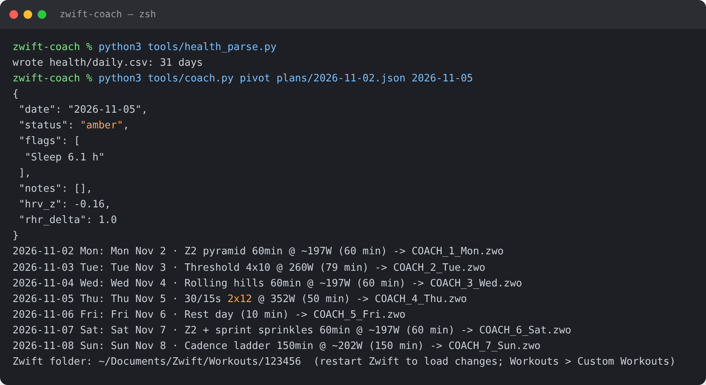
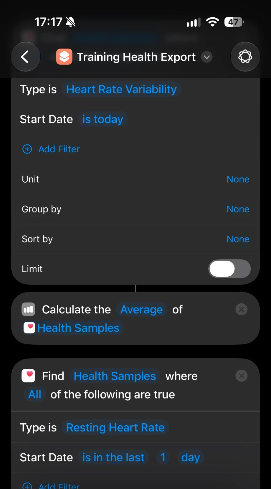
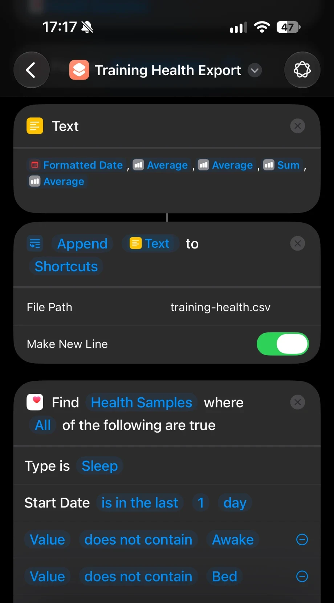
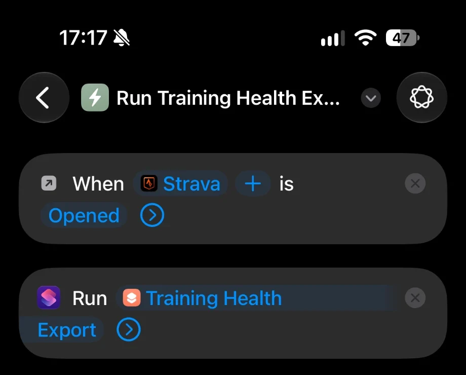
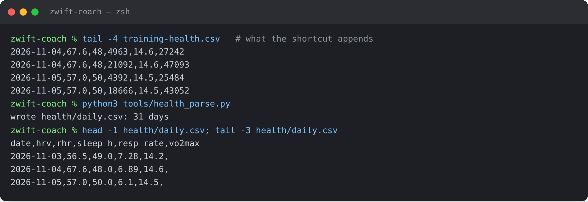
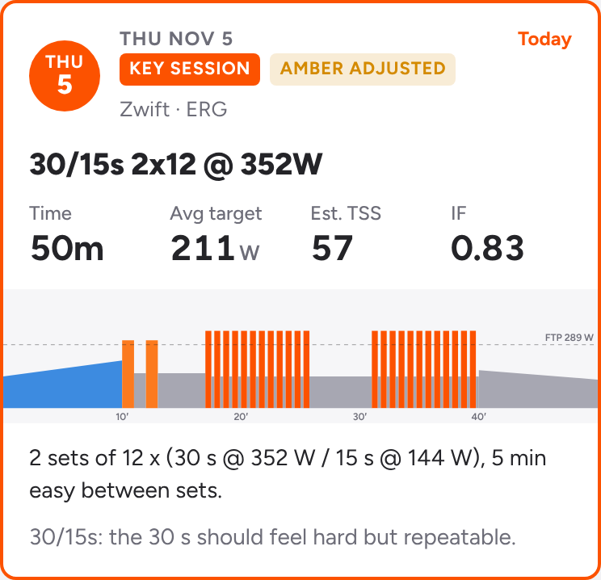
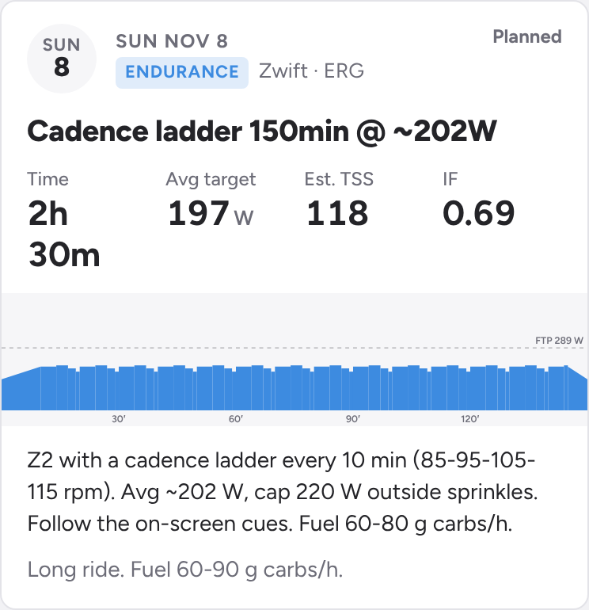

# zwift-coach

**a file-based cycling coach that rewrites today's zwift workout based on how i slept and how yesterday's ride went.**

it plans the season, writes every session into zwift in exact watts, and checks recovery each morning before i get on the bike. if the numbers are good, the workout stands. if they're not, it gets trimmed or swapped before i ever see it.

the current target is 289 → 330 w ftp by late april, on 7.5–10 hours a week, mostly indoors. it's built for one rider, but it's set up as a template, so fork it and change the numbers.


## how a morning works

my iphone exports last night's recovery data to icloud. the mac turns it into a readiness score: green, amber or red. then it applies that score to today's session and rewrites the zwift file.



that's a real run on sample data. sleep came in at 6.1 h, so thursday's 30/15s dropped from 3 sets to 2 and the zwift file was rewritten. by the time i open zwift, the workout is already the right one.

claude runs this on a schedule every morning, then reviews the week every sunday and builds the next one. every step also runs fine by hand.

## the iphone side

this is the part that took the most work, and the part i'd copy first. readiness only works if the data turns up every morning without me thinking about it.

one free apple shortcut, **training health export**, reads hrv, resting hr, sleep and respiratory rate, then appends a line to `iCloud Drive/Shortcuts/training-health.csv`.

<p>


</p>

each metric is a find health samples step followed by an average, or a sum for sleep. the text step joins them into one line, and append writes it to the csv with make new line switched on.

three automations run it:

| trigger | why |
|---|---|
| when waking up | fires early. sleep usually hasn't synced yet, but it catches hrv and resting hr |
| daily at 7:25 am | a backstop. it fails silently if the phone is locked, since ios blocks health reads on a locked phone |
| **when strava is opened** | the reliable one. the phone is unlocked, i'm up, and sleep has synced |



so there are a few lines per day, and that's expected. `health_parse.py` keeps the most complete one for each day and builds `health/daily.csv`.



a few things i learned the hard way:

- **"last 1 day" in shortcuts means since midnight yesterday, not the last 24 hours.** that covers two nights, so the shortcut logs two sleep totals and the parser subtracts one from the other. sleep shows up from the second morning
- **ios caps how much health data a shortcut can write.** respiratory rate pulled 151 samples and was blocked. limiting it to 10 fixed it
- **icloud evicts the csv.** the mac often keeps it cloud-only, so the morning run reads nothing. right-click the file in finder → keep downloaded
- **set the two append steps to always allow.** otherwise the automation stalls waiting for a tap nobody sees
- **wear the watch to bed.** no overnight data means no hrv baseline

need a baseline on day one? export all health data from the health app, unzip it into `health/apple_health_export/`, and the parser picks up months of history at once. the full shortcut build and a paid alternative (health auto export) are in [`health/readme.md`](health/readme.md).

## when recovery's off



the baseline is the previous 28 days. hrv is log-transformed and averaged over 3 days, so one bad night doesn't wreck a week.

| status | triggers | what changes |
|---|---|---|
| green | no flags | ride as written |
| amber | hrv z < −1, resting hr > +3 bpm, or sleep 5.5–6.5 h | key session drops a rep and 3% watts, z2 is cut 25%, tests are postponed |
| red | hrv z < −2, resting hr > +5 two days running, sleep < 5.5 h, breathing rate > +1.5, or two amber flags | 30-min recovery spin, and the key session moves to a later safe day or drops |

a safe day is never a required rest day and never next to another key session. running the pivot twice on the same day doesn't stack the trims.

## how sessions progress

after each key session the routine pulls the strava streams and scores every rep. a rep counts if average power held within 3% of target for 95% of it.

- **all reps, hr to spare:** +5 w or +1 rep next time
- **one rep missed:** repeat it
- **two or more missed:** −5 w, then check readiness and fuelling
- **long rides:** hr drift under 5% adds 15 minutes next time. over 8% holds the duration and adds a fuelling cue every 15 minutes

the full rulebook is [`coach.md`](coach.md). if you want to change how it coaches, change it there, not in the prompts.

## what lands in zwift

each weekday has a fixed slot, `COACH_1_Mon.zwo` to `COACH_7_Sun.zwo`, which gets overwritten every week, so the custom workouts list never grows. workouts are stored as a percentage of ftp, so **zwift's ftp setting has to match `config.json`**. if they don't match, every target shifts.



z2 days rotate through four formats so endurance rides don't turn into staring at one number:

- **ladder:** same power, cadence climbs 85 → 95 → 105 → 115 rpm every 10 min
- **hills:** 4 min seated at 70 rpm near the top of z2, then 3 min spinning at 95
- **sprinkles:** a 10-s acceleration every 8 min. never the day before a key session, never on rides of 90 min or more
- **pyramid:** 3-min steps from 62% to 74% and back, with changing cadence

long rides can also finish with late efforts on tired legs or a few sprints, and they get a fuelling cue every 20 minutes.

## setup

you'll need python 3.9+, `numpy` (for ride metrics only) and zwift with a smart trainer.

```bash
git clone https://github.com/brodyisaak/zwift-coach.git && cd zwift-coach
cp config.example.json config.json                  # ftp, gates, zwift id, health folder
cp plans/example-week.json plans/2026-11-02.json    # plans are named by their monday
python3 tools/coach.py show  plans/2026-11-02.json  # check the week in watts
python3 tools/coach.py build plans/2026-11-02.json  # write the .zwo files into zwift
```

restart zwift, then go to workouts → custom workouts. your zwift id is the folder name under `~/Documents/Zwift/Workouts/`.

to put it on a schedule, paste [`prompts/daily-routine.md`](prompts/daily-routine.md) into a scheduled claude task for every morning, and [`prompts/weekly-review.md`](prompts/weekly-review.md) into one for sunday evening. claude needs access to this folder and strava. google calendar is optional, for ride blocks around work.

<details>
<summary><b>all commands</b></summary>

```bash
python3 tools/health_parse.py                         # apple health → health/daily.csv
python3 tools/coach.py readiness [YYYY-MM-DD]         # green / amber / red
python3 tools/coach.py pivot plans/<week>.json [DATE] # apply readiness and rebuild
python3 tools/coach.py build plans/<week>.json        # write the week into zwift
python3 tools/coach.py show  plans/<week>.json        # print the week in watts
python3 tools/ride_metrics.py streams.json <FTP>      # np, tss, zones, best 1/5/20/60 min
python3 tools/week_card.py [--next]                   # phone page data → share/week.json
python3 tools/calendar_blocks.py plans/<week>.json    # calendar blocks for the week
```

</details>

<details>
<summary><b>session library</b></summary>

| key | session | params |
|---|---|---|
| `ftp_test` | 5-min benchmark + 20-min test | — |
| `threshold` | sub-threshold and threshold reps | `reps`, `on_sec`, `pct`, `off_sec` |
| `vo2_3015` | 30/15s | `sets`, `reps`, `pct` |
| `vo2_long` | 4–5 min vo2 reps | `reps`, `on_sec`, `pct` |
| `over_under` | over-unders | `reps`, `blocks`, `under`, `over` |
| `sweet_spot` | sweet spot reps | `reps`, `on_sec`, `pct` |
| `endurance` | z2, four styles | `minutes`, `pct`, `style`, `late_efforts`, `finish_sprints`, `fuel_every_min` |
| `recovery` · `openers` · `rest` | — | — |

`pct` is a fraction of ftp. a plan is one json file covering monday to sunday. see [`plans/example-week.json`](plans/example-week.json) and the sample output in [`examples/zwo/`](examples/zwo/).

</details>

<details>
<summary><b>folder layout</b></summary>

| path | what |
|---|---|
| `coach.md` | the rulebook the routines follow |
| `season-plan.md` | blocks, gates and the weekly template |
| `research/` | the evidence behind the intensity balance |
| `health/` | apple health setup. your data lands here and stays local |
| `plans/` | one json file per week |
| `tools/` | the engine |
| `prompts/` | daily and weekly routine prompts |
| `web/training-week.html` | the phone page |
| `docs/` | screenshots. the terminal and phone page grabs use sample data |
| `examples/zwo/` | sample zwift workouts |

</details>

## the plan behind it

27 weeks in seven blocks: three build weeks and a recovery week, with ftp test gates in december and february. it's pyramidal through the base and polarized from february. the plan is in [`season-plan.md`](season-plan.md), and the research behind the intensity balance is in [`research/`](research/aerobic-anaerobic-balance.md).

## notes

- personal data (`config.json`, health exports, dated plans, daily notes, reviews and the training log) is in `.gitignore` and stays on your machine
- not medical advice. if the numbers and how you feel both point to illness or overreaching, rest
- the rules are tuned to one rider's history and hours. treat `coach.md` and `season-plan.md` as a starting point

## licence

mit
