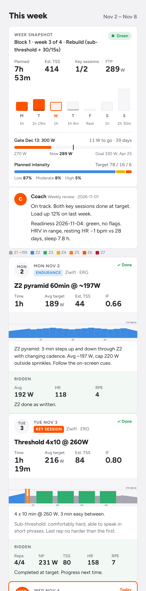

# zwift-coach

a file-based cycling coach that runs my indoor winter. it plans the season, writes every workout straight into zwift in exact watts, and rewrites today's session each morning based on how i slept and how yesterday's ride actually went.

the current target is **289 → 330 w ftp by late april**, 7.5–10 hours a week, mostly on zwift. it's built for one rider and shared as a template. fork it, change the numbers, keep what works.



## the loop

```
iphone (overnight)          mac (morning)                       zwift (evening)
─────────────────           ──────────────                      ───────────────
watch records hrv,     →    health_parse.py → daily.csv    →    custom workouts
resting hr, sleep,          readiness: green / amber / red      COACH_1_Mon … COACH_7_Sun
breathing rate              pivot: trim, swap or ride as written
shortcut appends a          strava: score yesterday's reps,
line to icloud              progress the next key session
```

every morning the routine reads recovery data from apple health and yesterday's ride from strava, decides whether today stands, and overwrites today's `.zwo` file. sunday evening it reviews the week and builds the next one. by the time i open zwift the workout is already the right one.

## iphone automations

this is the part that took the most iteration, and the part i'd steal first if i were you. readiness only works if the data arrives every morning without me thinking about it.

### the shortcut

one free apple shortcut, **training health export**, appends a single line to `iCloud Drive/Shortcuts/training-health.csv`:

```
yyyy-MM-dd, hrv_ms, resting_hr, sleep_today_s, resp_rate, sleep_since_yesterday_s
```

it's six actions:

1. find health samples → heart rate variability, start date is today → average
2. find health samples → resting heart rate, last 1 day → average
3. find health samples → sleep, start date is today, value not "awake" or "in bed" → sum of durations
4. find health samples → respiratory rate, start date is today, **limit 10** → average
5. format the date, build the line, append to `training-health.csv`
6. sleep again over "the last 1 day" → append the second sum to the same line

### three automations, on purpose

all three run the same shortcut, with no notification:

| trigger | why it's there |
|---|---|
| when waking up | fires early. usually before the watch has synced last night's sleep, but it reliably catches hrv and resting hr |
| daily at 7:25 am | a backstop. fails silently if the phone is locked, because ios blocks health reads on a locked phone |
| **when strava is opened** | the reliable one. the phone is unlocked, i'm awake, and sleep has synced |

so there are several lines per day, and that's expected. `tools/health_parse.py` keeps the most complete run for each day and ignores the rest.

### things i learned the hard way

- **"last 1 day" is a calendar window, not 24 hours.** it covers yesterday 00:00 to now, which is two nights. that's why the shortcut logs two sleep sums. last night = `since_yesterday(today) − today(yesterday)`. it needs one previous morning's line, so sleep shows up from the second morning. anything outside 1–11 h is thrown out
- **ios caps how much health data a shortcut can write to a file.** respiratory rate with no limit pulled 151 samples and was blocked. capping it at 10 fixed it. if you hit the limit anyway: settings → apps → shortcuts → advanced → allow sharing large amounts of data
- **icloud evicts the csv.** the mac often keeps it cloud-only, and the morning run reads nothing. in finder, right-click the file → keep downloaded
- **grant the narrowest permissions.** the shortcut reads hrv, resting hr, sleep and respiratory rate only. set the two append steps to always allow, or the automation stalls waiting for a tap nobody sees
- **wear the watch to bed.** no overnight data means no hrv baseline. without sleep, readiness runs on hr and hrv alone and says so

### backfill and alternatives

- **day-one baseline:** readiness needs 7+ days of history. health app → profile → export all health data, unzip into `health/apple_health_export/`, and the parser picks up months of history at once
- **health auto export (paid):** if you'd rather not maintain a shortcut, its icloud automation drops daily json files the parser also reads. full steps are in [`health/readme.md`](health/readme.md)

## readiness

the baseline is the previous 28 days. hrv is log-transformed and smoothed over 3 days so one bad night doesn't wreck a week.

| status | triggers | what changes |
|---|---|---|
| green | no flags | ride as written |
| amber | hrv z < −1, resting hr > +3 bpm, or sleep 5.5–6.5 h | key session drops a rep and 3% watts, z2 is cut 25%, tests are postponed |
| red | hrv z < −2, resting hr > +5 two days running, sleep < 5.5 h, breathing rate > +1.5, or two amber flags | 30-min recovery spin. the key session moves to a safe later day, or drops |

a "safe day" is never a required rest day and never next to another key session. re-running the pivot on the same day is safe: it always starts from the original session, so trims don't stack.

## how sessions progress

after each key session the routine pulls the strava streams and scores every rep. a rep counts if average power held within 3% of target for 95% of it.

- **all reps, hr to spare:** progress next time (+5 w or +1 rep)
- **one rep missed:** repeat the session
- **two or more missed:** −5 w, then check readiness and fuelling
- **long rides:** hr drift under 5% adds 15 minutes next time. over 8% holds the duration and adds a fuelling cue every 15 minutes

the full rulebook is [`coach.md`](coach.md). change behaviour there, not in the prompts.

## what goes into zwift

each weekday has a fixed slot (`COACH_1_Mon.zwo` … `COACH_7_Sun.zwo`) that gets overwritten every week, so zwift's custom workout list never grows. workouts are stored as a % of ftp, so **zwift's ftp setting has to match `config.json`**, or every target shifts.

z2 days rotate through four formats so endurance work doesn't turn into staring at a number:

| style | what it is |
|---|---|
| `ladder` | same power, cadence climbs 85 → 95 → 105 → 115 rpm every 10 min |
| `hills` | 4 min seated at 70 rpm near the top of z2, then 3 min spinning at 95 |
| `sprinkles` | a 10-s acceleration every 8 min. never the day before a key session, never on rides of 90 min or more |
| `pyramid` | 3-min steps from 62% to 74% and back, with changing cadence |

long rides can also take `late_efforts` (threshold work on tired legs) and `finish_sprints` (a small anaerobic dose), with a fuelling cue every 20 minutes.

## setup

needs python 3.9+, `numpy` (ride metrics only) and zwift with a smart trainer.

```bash
git clone https://github.com/brodyisaak/zwift-coach.git && cd zwift-coach
cp config.example.json config.json                  # ftp, gates, zwift id, health folder
cp plans/example-week.json plans/2026-11-02.json    # plans are named by their monday
python3 tools/coach.py show  plans/2026-11-02.json  # sanity-check the week in watts
python3 tools/coach.py build plans/2026-11-02.json  # write the .zwo files into zwift
```

restart zwift, then go to workouts → custom workouts. your zwift id is the folder name under `~/Documents/Zwift/Workouts/`.

## running it

the engine is plain python, and every step can be run by hand. the coaching judgement comes from claude on a schedule, following `coach.md`:

| when | routine | prompt |
|---|---|---|
| every morning | parse health, score yesterday, pivot today, rewrite zwift | [`prompts/daily-routine.md`](prompts/daily-routine.md) |
| sunday evening | review the week, build next week | [`prompts/weekly-review.md`](prompts/weekly-review.md) |

the assistant needs this folder and strava. google calendar is optional, for ride blocks around work.

```bash
python3 tools/health_parse.py                         # apple health → health/daily.csv
python3 tools/coach.py readiness [YYYY-MM-DD]         # green / amber / red
python3 tools/coach.py pivot plans/<week>.json [DATE] # apply readiness and rebuild
python3 tools/coach.py build plans/<week>.json        # write the week into zwift
python3 tools/ride_metrics.py streams.json <FTP>      # np, tss, zones, best 1/5/20/60 min
python3 tools/week_card.py [--next]                   # phone page data → share/week.json
python3 tools/calendar_blocks.py plans/<week>.json    # calendar blocks for the week
```

### session library

| key | session | params |
|---|---|---|
| `ftp_test` | 5-min benchmark + 20-min test | — |
| `threshold` | sub-threshold and threshold reps | `reps`, `on_sec`, `pct`, `off_sec` |
| `vo2_3015` | 30/15s | `sets`, `reps`, `pct` |
| `vo2_long` | 4–5 min vo2 reps | `reps`, `on_sec`, `pct` |
| `over_under` | over-unders | `reps`, `blocks`, `under`, `over` |
| `sweet_spot` | sweet spot reps | `reps`, `on_sec`, `pct` |
| `endurance` | z2, four styles | `minutes`, `pct`, `style`, `late_efforts`, `finish_sprints`, `fuel_every_min` |
| `recovery` · `openers` · `rest` | — | — |

`pct` is a fraction of ftp. a plan is one mon–sun json file. see [`plans/example-week.json`](plans/example-week.json) and the generated output in [`examples/zwo/`](examples/zwo/).

## the plan behind it

27 weeks in seven blocks: three build weeks and a recovery week, with ftp test gates in december and february. pyramidal through the base, polarized from february. the plan is in [`season-plan.md`](season-plan.md), and the evidence behind the intensity balance is in [`research/`](research/aerobic-anaerobic-balance.md).

## layout

| path | what |
|---|---|
| `coach.md` | the rulebook the routines follow |
| `season-plan.md` | blocks, gates, weekly template |
| `research/` | why the intensity balance looks the way it does |
| `health/` | apple health setup. your data lands here and stays local |
| `plans/` | one json file per week |
| `tools/` | the engine |
| `prompts/` | daily and weekly routine prompts |
| `web/training-week.html` | the phone page |
| `examples/zwo/` | sample zwift workouts |

personal data (`config.json`, health exports, dated plans, daily notes, reviews, the training log) is in `.gitignore` and never leaves the machine.

## notes

- not medical advice. if the numbers and how you feel both point to illness or overreaching, rest
- the rules are tuned for one rider's history and hours. treat `coach.md` and `season-plan.md` as a starting point

## licence

mit
